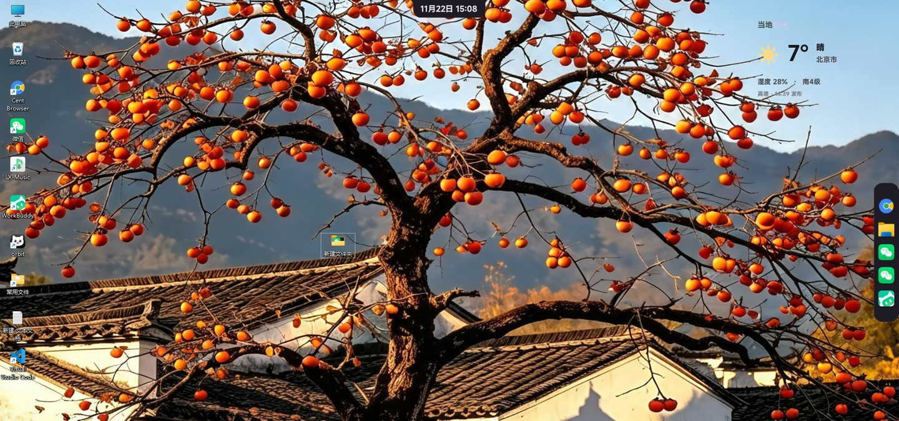
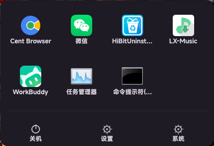
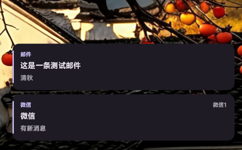
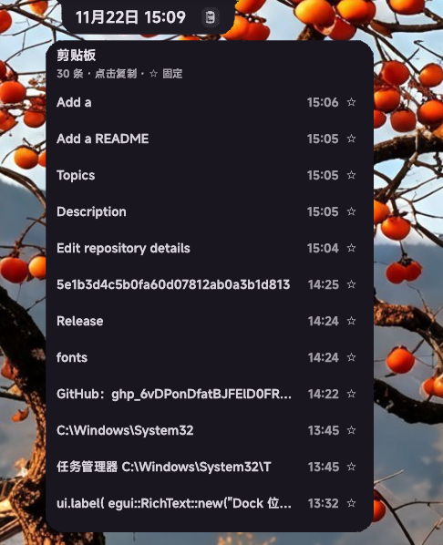

<div align="center">


# Orbit

**Windows 11 桌面增强悬浮栏**

[](https://github.com/MemoryCollection/Orbit-Rust/releases/latest)
[](#)
[](#)
[](#)
[](https://github.com/MemoryCollection/Orbit-Rust/releases)
[](LICENSE)

</div>

---

**Orbit** 用一条悬浮的「胶囊 + Dock」替代 Windows 原生任务栏：顶部胶囊显示时钟、天气、邮件、剪切板等模块，底部 Dock 承载钉选应用与**完整托盘托管**，配合通知横幅、开始菜单接管、微信消息卡片等桌面增强。

Rust + 原生 Win32 + egui 软件光栅化实现——**没有 WebView、没有浏览器内核**，整个程序是一个约 6 MB 的单文件 exe，界面是逐像素透明的圆角分层窗口，点击不抢焦点、不占用工作区，浏览器照样全屏。

## 界面预览

全桌面效果：顶部胶囊（时钟）+ 右侧竖排 Dock + 右上角天气卡片，原生任务栏已接管：



各模块细节：

<table>
  <tr>
    <td align="center" width="33%"><br><sub><b>桌面天气卡片</b>（高德 / Open-Meteo）</sub></td>
    <td align="center" width="33%"><br><sub><b>开始菜单</b>（Win 键接管）</sub></td>
    <td align="center" width="33%"><br><sub><b>通知横幅</b>（邮件 / 微信，可堆叠）</sub></td>
  </tr>
  <tr>
    <td align="center"><br><sub><b>剪切板模块</b>（胶囊展开面板）</sub></td>
    <td align="center"><br><sub><b>侧边 Dock</b>（左 / 右锚位）</sub></td>
    <td align="center"><br><sub><b>波浪悬停放大</b>（冒出部分可点击）</sub></td>
  </tr>
  <tr>
    <td align="center" colspan="3"><br><sub><b>邮件模块条</b>（未读数 + 验证码抽取）</sub></td>
  </tr>
</table>

## 功能一览

| 模块 | 说明 |
|---|---|
| **顶部胶囊** | 时钟 / 日期（strftime 风格格式串可配）+ 可分离模块条。天气 / 邮件 / 剪切板模块可拖动排序，独立摆放在胶囊左 / 右侧或隐藏，点击弹出展开面板 |
| **音乐条** | 旋转专辑封面 + 歌词逐句显示（按曲目自动搜网易云取 LRC），可摆放在胶囊右侧 / 左侧 / 下方，支持统一透明度 |
| **底部 Dock** | 钉选应用 + 运行中应用 + **完整托盘托管**——隐藏原生任务栏后系统托盘图标不丢，左右键菜单 / 悬停预览 / 回调全部原样转发 |
| **波浪放大** | 鼠标掠过 Dock 时图标 macOS 同款高斯波浪放大，冒出底板的半截同样可以正常点击 |
| **通知横幅** | 右下角统一卡片式提醒：微信消息 / 邮件验证码 / 托盘闪烁 / 剪切板 / 系统通知，可堆叠、点击跳转对应程序；设置页可调大小（拖动滑块实时预览）与停留时长 |
| **桌面天气卡片** | 桌面右上角常驻天气卡片，高德 / Open-Meteo 双数据源，字号可调 |
| **开始菜单接管** | Win 键弹出 Orbit 风格开始菜单，快捷方式可自定义、可提权（`@admin:` 前缀） |
| **微信消息卡片** | 双通道提醒：① **监听托盘图标闪烁**（图标反复亮灭）——不依赖微信版本，新消息立刻触发提示音 / 横幅；② **UIA 读取聊天列表**补充未读数与摘要，点击跳回对应微信窗口（多开按 PID 区分） |
| **提示音** | 内置多档提示音（一声 / 两声 / 三声 / 循环到横幅消失），按消息来源独立配置 |
| **守护与自启** | `orbit-guard.exe` 守护进程：主程序被强杀后自动救回任务栏并复活（最多 3 次）；支持注册表 / 启动文件夹 / 计划任务三种开机自启 |
| **设置页** | 分组导航可视化配置：主题（3 套 × 深 / 浅）、界面透明度、圆角、字体（内置 MiSans / 系统字体）、各模块独立开关与排列、Dock 锚位（下 / 上 / 左 / 右）等 |

## 下载与运行

从 [Releases](https://github.com/MemoryCollection/Orbit-Rust/releases/latest) 下载 `Orbit-vX.Y.Z.zip`，解压后**保持两个 exe 和 `data` 目录在同一文件夹**，运行 `orbit.exe` 即可：

```
Orbit/
├── orbit.exe          主程序（日常只需要运行它）
├── orbit-guard.exe    守护副本（主程序自动拉起，勿单独运行）
└── data/
    └── MiSans-Semibold.ttf   界面字体（缺失时自动回落系统字体）
```

启动后默认接管（隐藏）原生任务栏，退出时自动恢复。所有配置便携式存储在 exe 旁的 `data/` 目录，不写注册表数据，删掉文件夹即完成卸载。

## 从源码构建

```bash
git clone https://github.com/MemoryCollection/Orbit-Rust.git
cd Orbit-Rust
cargo build --release        # 产物在 target/release/orbit.exe
cargo test                   # 单元测试
cargo run --release -- --show-taskbar   # 保留原生任务栏运行（调试）
```

无外部运行时依赖，仅需 Rust stable（edition 2021）与 Windows 11（23H2 为主力目标）。

## 命令行参数

| 参数 | 作用 |
|---|---|
| （无参数） | 默认接管（隐藏）原生任务栏，退出自动恢复 |
| `--show-taskbar` | 保留原生任务栏运行（调试 / 临时体验） |
| `--restore-taskbar` | 进程被强杀、任务栏未归位时手动救回 |
| `--settings-ui` | 启动设置页（由主程序内部调用） |

## 快捷键

| 快捷键 | 作用 |
|---|---|
| `Ctrl + Alt + O` | 退出 Orbit（任务栏自动恢复） |
| `Ctrl + Alt + ,` | 打开设置页 |
| `Win` | 弹出 Orbit 开始菜单（接管后） |

## 配置

所有设置可在**设置页**可视化调整，也可直接编辑 `data/settings.txt`——**改文件即时生效，无需重启**。常用键：

| 键 | 说明 | 默认 |
|---|---|---|
| `alpha` | 界面整体透明度（0 ~ 1） | `0.85` |
| `pill_scale` / `icon_scale` | 胶囊 / Dock 图标大小倍率 | `1` |
| `banner_scale` | 通知横幅大小倍率（0.8 ~ 1.5） | `1` |
| `corner_radius` | 统一圆角半径（0 = 直角） | `14` |
| `module_order` | 模块排列顺序（时间固定第一） | `weather,mail,clipboard` |
| `*_mode` | 各模块位置：`pill` / `left` / `right` / `off` | `left` / `right` |
| `dock_anchor` | Dock 锚位：`bottom` / `top` / `left` / `right` | `bottom` |
| `theme` | 主题：calm / glass2 / m3 × dark / light | `calm_dark` |
| `font` | `misans`（随包分发）/ `system` | `misans` |
| `clock_format` | 时钟格式串（strftime 风格） | `%H:%M %m月%d日 %a` |

## 数据与隐私

- 全部数据（设置、邮件缓存、剪切板记录等）便携式落在 `<exe>/data/`，不写注册表数据、不碰安装目录之外（仅开机自启使用注册表 Run 键 / 启动文件夹 / 计划任务）。
- 网络请求仅限：天气（高德 / Open-Meteo）、歌词搜索（网易云）、IMAP 邮箱收信——全部可关闭。
- 本地日志写在 `<exe>/orbit.log`（设置 `ORBIT_TRACE=1` 环境变量开启详细日志）。

## 技术实现

- **绘制链路**：所有分层窗口统一走 egui 立即模式布局 → `egui_soft` 软件光栅化 → 预乘 RGBA → `UpdateLayeredWindow` 上屏，透明度烘焙进像素，无 DWM 模糊依赖。
- **窗口特性**：`WS_EX_NOACTIVATE` + 逐像素 alpha + 圆角 `WM_NCHITTEST` 穿透，置顶但不抢焦点、不注册 AppBar，不占用工作区。
- **托盘完整托管**：假 `Shell_TrayWnd` 窗口 + `TaskbarCreated` 重注册 + `WM_COPYDATA` 图标表，配合回调消息转发实现「隐藏原生任务栏 + 悬停弹卡片 + 稳定镜像」三者同时成立。
- **进程模型**：主进程承载全部界面；设置页是独立子进程（改值跨进程通知即时生效）；`orbit-guard.exe` 守护副本监视主进程 PID，强杀后救回任务栏并复活。
- 全部代码约 2.6 万行 Rust，依赖极少（`windows` crate + egui），单文件约 6 MB。

## 文档

| 文档 | 内容 |
|---|---|
| [docs/ARCHITECTURE.md](docs/ARCHITECTURE.md) | 架构总览、模块关系、关键设计与踩坑记录 |
| [docs/FILEMAP.md](docs/FILEMAP.md) | 源码文件索引（先查表再读代码） |
| [docs/HANDOVER.md](docs/HANDOVER.md) | 交接文档：构建、验证、开发约定 |

## 已知限制

- 面向 **Windows 11**（23H2 为主力目标）与**主显示器**设计，未做多屏适配。
- 仅支持 x64。
- 界面在 14 寸 / 1920×1080 笔记本屏上开发与验证，高分辨率 / 高 DPI 屏上的显示效果尚未充分验证，欢迎反馈截图。
- 微信消息采用两套机制：**托盘图标闪烁监听**通用且不依赖微信版本（任何会闪的托盘图标都会触发提示音 / 横幅）；**未读数与摘要**依赖微信客户端 UIA 树，微信大版本更新可能影响读取（可随时关闭该功能）。

## 许可与致谢

- 代码以 **MIT License** 开源，详见 [LICENSE](LICENSE)。
- **MiSans Semibold** 字体版权归北京小米移动软件有限公司所有，依据小米官方字体许可随包分发，仅用于本程序界面显示；也可在设置中切换为系统字体（字体不在 MIT 许可范围内）。
- 界面图标捕获自系统与应用本身，版权归各自作者。
